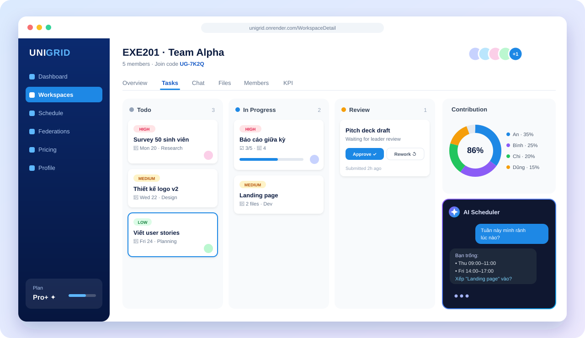
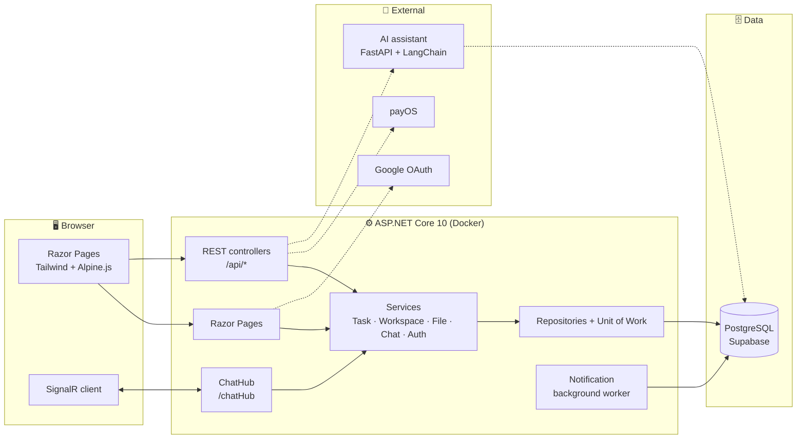
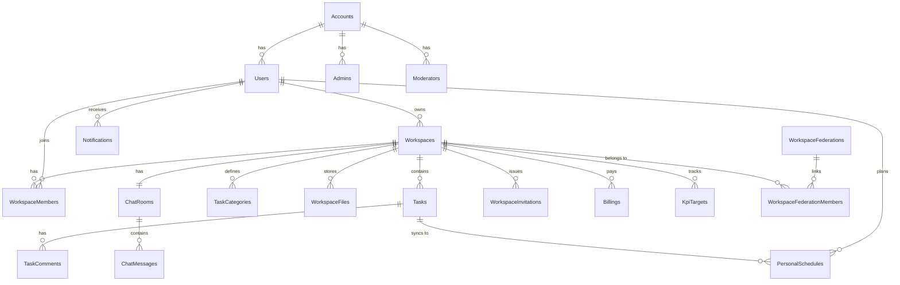

<div align="center">



<br/><br/>

### One workspace for tasks, deadlines, files, team chat — and an AI that plans your week.

**Built for student teams, academic clubs and small startups (3–10 people) who are tired of juggling Zalo, Messenger, Google Docs and a spreadsheet nobody updates.**

<br/>

[](https://dotnet.microsoft.com/)
[](https://supabase.com/)
[](https://learn.microsoft.com/aspnet/core/signalr/)
[](https://tailwindcss.com/)
[](https://alpinejs.dev/)
[](https://render.com/)
<br/>
[](https://www.langchain.com/)
[](https://fastapi.tiangolo.com/)
[](https://groq.com/)
[](https://payos.vn/)

[**🌐 Live demo**](https://unigrid.onrender.com) · [**✨ Features**](#-features) · [**🤖 AI Scheduler**](#-ai-scheduler) · [**🚀 Quick start**](#-quick-start) · [**☁️ Deploy**](#️-deploy-render--supabase) · [**🏗️ Architecture**](#️-architecture)

<br/>



</div>

---

## 💡 Why UniGrid?

Group work usually breaks down the same way: tasks get lost in chat threads, deadlines live in someone's head, files are scattered across drives, and nobody can tell who actually did the work.

UniGrid puts all of it in one place:

| Problem | UniGrid's answer |
| :--- | :--- |
| 📌 "Who is doing this?" | Every task has **one assignee, one deadline, one status** |
| 📅 "I forgot the deadline" | Assigned deadlines **sync straight into each member's personal calendar** |
| 🫥 Free-riders | **Contribution metrics** show each member's completion rate |
| 💬 Chat chaos | **One focused real-time group chat** per workspace |
| 📂 "Where is that file?" | A **shared file repository** next to the tasks it belongs to |
| 🏢 Many teams, no overview | **Federations** roll several workspaces up into one executive dashboard |
| 🤯 "When do I even do this?" | The **AI Scheduler** finds a free slot before the deadline and books it |

### ⚡ The killer feature: deadlines that follow you



When a leader assigns a task, the deadline lands on the assignee's personal calendar right next to their classes, gym and club meetings. No copy-paste, no "did you see my message?".

---

## ✨ Features

<table>
<tr>
<td width="50%" valign="top">

### 📋 Kanban task engine
- 4-stage board: `Todo` → `In Progress` → `Review` → `Done`
- Drag-and-drop status changes
- Priorities, deadlines, categories, comments
- Leader review flow: **Approve & Close** or **Request Rework**

</td>
<td width="50%" valign="top">

### 📅 Native calendar sync
- Personal schedule + team deadlines on one calendar
- Assigning a task drops the deadline into the assignee's calendar automatically
- Dashboard cards for total, pending and overdue work

</td>
</tr>
<tr>
<td valign="top">

### 💬 Real-time chat
- Powered by **ASP.NET Core SignalR** (WebSockets)
- One `#general` room per workspace to keep teams focused
- In-app notifications with a background worker

</td>
<td valign="top">

### 📂 File repository
- Shared workspace files, optionally attached to tasks
- Storage quota per plan
- Downloads gated by workspace membership

</td>
</tr>
<tr>
<td valign="top">

### 🌐 Workspace federations
- Link Business-tier workspaces into one federation
- Aggregated progress, workload and activity for managers
- No duplicated files: one source of truth

</td>
<td valign="top">

### 📈 KPIs & analytics
- Per-member KPI targets and completion tracking
- Admin dashboard: users, subscriptions, traffic, monthly costs
- Privacy-friendly page-view counts (no IPs, no cookies)

</td>
</tr>
<tr>
<td valign="top">

### 💳 Plans & payments
- Tiers: **Free · Personal · Pro · Pro+ · Business**
- Checkout via **payOS** with webhook confirmation
- Billing history per workspace

</td>
<td valign="top">

### 🤖 AI Scheduler
- Chat in plain Vietnamese or English: *"tuần sau mình bận gì?"*
- Books unscheduled tasks into free slots before their due date
- Tool-using LangChain agent, [details below ↓](#-ai-scheduler)

</td>
</tr>
</table>

### 👥 Who uses it

| Role | Can do |
| :--- | :--- |
| **Guest** | Browse the landing and pricing pages, sign up, log in (email or Google) |
| **Member** | Join via code, work on assigned tasks, chat, upload files, manage their calendar |
| **Workspace owner** | Create workspaces, invite/remove members, assign and review tasks, upgrade plans |
| **Admin** | Manage users and subscriptions, lock accounts, review federations, traffic and costs |

---

## 🤖 AI Scheduler



UniGrid ships with **Scheduler**, an AI agent that lives in a chat bubble on the **Schedule** page and works directly on your personal calendar.

**What you can ask**

| You say | Scheduler does |
| :--- | :--- |
| *"Tuần này mình có gì?"* | Reads your week and summarises it in UTC+7 |
| *"Mình còn task nào chưa xếp lịch?"* | Lists tasks assigned to you that aren't on your calendar yet |
| *"Xếp task báo cáo vào sáng thứ 5"* | Finds the task, checks the due date and conflicts, books a slot |
| *"Dời buổi họp nhóm sang thứ 6"* | Moves the event and confirms the new time |
| *"Bạn tự chọn giờ đi"* | Picks a sensible slot instead of asking again |

**How it works**

1. The chat widget posts to **`/api/assistant/ask`** on the ASP.NET Core app.
2. The app resolves the logged-in user from the auth cookie and forwards the request to the Python service with an **`X-User-Id`** header. The user id never comes from the chat text.
3. The **FastAPI + LangChain** agent runs a tool-calling loop (up to 10 steps) on **`openai/gpt-oss-120b` via Groq**, or a local **Ollama** model.
4. Five tools read and write **Supabase Postgres** directly: `get_schedule_for_week`, `get_unscheduled_tasks`, `get_event_details`, `schedule_task`, `reschedule_event`.

**Guardrails built into the agent**

- 🔒 Only ever touches **the current user's own** schedule; requests about other people are declined.
- 🙈 Never shows or asks for internal IDs; it resolves them itself through tools.
- ⛔ Refuses to schedule a task **after its due date** and reports conflicts instead of overwriting.
- 🧮 Never does date math in its head: relative dates ("next week") go through the week tool.
- 🌐 Answers in the language you wrote in.

---

## 🏗️ Architecture



**Layers**

- **Presentation:** Razor Pages render the views, REST controllers (`Tasks`, `Events`, `Kpi`, `Notifications`, `Billing`, `Assistant`, `Auth`) power the interactive parts, and `ChatHub` handles real-time chat.
- **Business logic:** `TaskService`, `WorkspaceService`, `FileService`, `ChatService`, `NotificationService`, `AuthService`, `AIAssistantService`.
- **Data access:** EF Core with Npgsql, typed repositories and a Unit of Work, and retry policies for cloud database cold starts.

### 🧰 Tech stack

| Layer | Technology |
| :--- | :--- |
| Backend | ASP.NET Core 10 · Razor Pages · Web API · SignalR |
| Database | PostgreSQL (Supabase) · Entity Framework Core 10 · Npgsql |
| Frontend | Tailwind CSS · Alpine.js · Lucide icons |
| Auth | Cookie auth · JWT bearer · Google OAuth |
| Payments | payOS |
| AI service | Python · FastAPI · LangChain · Groq / Ollama |
| Hosting | Docker · Render · Supabase |

---

## 🗄️ Data model

The schema has 23 tables. These are the core relationships:



The full PostgreSQL schema is in [`unigrid/Data/SupabaseSchema.sql`](unigrid/Data/SupabaseSchema.sql). You can also skip it: the app creates any missing tables on first start.

---

## 🚀 Quick start

### Prerequisites

- [.NET SDK 10](https://dotnet.microsoft.com/download)
- A PostgreSQL database. A free [Supabase](https://supabase.com/) project works.
- *(Optional)* Python 3.11+ for the AI assistant

### 1. Clone

```bash
git clone https://github.com/Kayden2311/UniGrid.git
```

```bash
cd UniGrid/unigrid
```

### 2. Configure local secrets

Copy `appsettings.local.json.example` to `appsettings.local.json` and fill it in. This file is git-ignored and is only loaded in Development.

```json
{
  "ConnectionStrings": {
    "DefaultConnection": "Host=<pooler-host>;Port=5432;Database=postgres;Username=postgres.<project-ref>;Password=<password>;SSL Mode=Require;Trust Server Certificate=true"
  },
  "Authentication": {
    "Google": { "ClientId": "<client-id>", "ClientSecret": "<client-secret>" }
  },
  "PayOS": {
    "ClientId": "<id>", "ApiKey": "<key>", "ChecksumKey": "<checksum>",
    "ReturnUrl": "http://localhost:5181/Pricing?payment=returned",
    "CancelUrl": "http://localhost:5181/Pricing?payment=cancelled"
  }
}
```

> 💡 In Supabase, click **Connect** → **Session pooler** to get the host and username.

### 3. Run

```bash
dotnet run
```

Open **http://localhost:5181**. On first start the app creates the database tables and default plan settings.

### 4. *(Optional)* AI assistant

```bash
cd Python && pip install -r requirements.txt && uvicorn runeterra.api:app --port 8000
```

The web app calls it at `ChatbotService:BaseUrl` (default `http://127.0.0.1:8000/`).

---

## ☁️ Deploy (Render + Supabase)

Both services have free tiers.

**1. Database: Supabase**

Create a project, then run [`SupabaseSchema.sql`](unigrid/Data/SupabaseSchema.sql) in the **SQL Editor** (or let the app create the tables).

**2. App: Render (Docker)**

Create a **Web Service** from this repo:

| Setting | Value |
| :--- | :--- |
| Language | Docker |
| Root Directory | *(empty)* |
| Dockerfile Path | `unigrid/Dockerfile` |
| Docker Build Context | `unigrid` |
| Health Check Path | `/` |

**3. Environment variables**

| Key | Required | Notes |
| :--- | :---: | :--- |
| `ConnectionStrings__DefaultConnection` | ✅ | Supabase session-pooler connection string |
| `Jwt__Key` | ✅ | Random string, 32+ characters |
| `Authentication__Google__ClientId` | ➖ | Google login |
| `Authentication__Google__ClientSecret` | ➖ | Google login |
| `PayOS__ClientId` · `PayOS__ApiKey` · `PayOS__ChecksumKey` | ➖ | Payments |
| `PayOS__ReturnUrl` · `PayOS__CancelUrl` · `PayOS__WebhookUrl` | ➖ | `https://<app>.onrender.com/...` |
| `ChatbotService__BaseUrl` | ➖ | URL of the deployed AI service |

**4. After the first deploy**

- Add `https://<app>.onrender.com/signin-google` to your Google OAuth redirect URIs.
- Register `https://<app>.onrender.com/api/billing/payos-webhook` as the payOS webhook.

> ⚠️ **Free tier limits:** Render free instances sleep after ~15 minutes of inactivity, so the first request is slow. The container disk is temporary, so uploaded files and data-protection keys are reset on each redeploy.

---

## 📁 Project structure

```
UniGrid/
├── README.md
├── unigrid.slnx
└── unigrid/
    ├── Controllers/      # REST API endpoints
    ├── Data/             # DbContext, initializer, repositories, SQL schema
    ├── Hubs/             # SignalR ChatHub
    ├── Models/           # EF Core entities
    ├── Pages/            # Razor Pages (Dashboard, Workspaces, Admin, ...)
    ├── Services/         # Business logic + background worker
    ├── Python/           # AI assistant (FastAPI + LangChain)
    ├── wwwroot/          # CSS, JS, images
    ├── Dockerfile
    └── Program.cs
```

---

## 🔒 Security notes

- Secrets never go in `appsettings.json`. Use `appsettings.local.json` locally (git-ignored) and environment variables in production.
- File downloads under `/files/{workspaceId}/...` check workspace ownership or membership.
- Traffic analytics store only aggregated page-view counts per day and path.

---

<div align="center">

Made with 💜 by the **UniGrid** team at FPT University

⭐ If UniGrid helps your team, give the repo a star!

</div>
